## Отчет по лабораторной работе 2

Система управления заказами доставкой и акциями

### Цель работы

Реализовать систему управления заказами способами доставки и акциями
Применить паттерны Наблюдатель Прокси Стратегия и Легковес
Показать взаимодействие объектов через перегрузку операторов

### Как устроена программа

OrderManager создает заказы и хранит их в vector через unique_ptr
Он ведет оборот число уникальных клиентов и счетчик активных заказов каждого клиента
Активным считается заказ который еще не доставлен и не отменен
Больше maxActiveOrders активных заказов на одного клиента создать нельзя

Order хранит покупателя регион товары статус доставку и список примененных акций
Итоговая цена считается каждый раз заново из цен товаров и стоимости доставки
Поэтому она не может устареть после скидки или подарка

Статус меняется только по правилам
pending переходит в paid или cancelled
paid переходит в shipped или cancelled
shipped переходит в delivered
Отправить заказ без назначенной доставки нельзя
После оплаты нельзя менять товары акции и доставку

Объявления лежат в include а реализация в src
Сценарии находятся в main.cpp а меню в Console.cpp
Каждый класс и интерфейс находится в отдельном файле

### UML диаграмма

[Исходник диаграммы](orders.mmd)

### Легковес

ProductType хранит общие данные вида товара это категория базовый вес и базовая цена
Все виды лежат в статическом пуле unordered_map
getType с весом и ценой создает вид только если его еще нет
getType только с категорией возвращает уже созданный вид
Product хранит только свое это id количество текущую цену и shared_ptr на вид
Поэтому сто книг в разных заказах ссылаются на один объект ProductType

### Стратегия

Delivery это общий интерфейс способа доставки
В нем есть getCost getEstimatedTime и isAvailable

| Класс | Стоимость | Срок | Вес |
|---|---|---|---|
| CourierDelivery | 500 | 1-2 дня | до 20 кг |
| PickupDelivery | 0 | 1-3 дня | без ограничений |
| PostDelivery | 200 | 5-10 дней | до 10 кг |

Discount это общий интерфейс акции с методом apply

| Класс | Что делает |
|---|---|
| PercentDiscount | уменьшает текущую цену каждого товара на 10 процентов |
| CashbackDiscount | начисляет 5 процентов суммы товаров на бонусный счет |
| FreeDeliveryDiscount | обнуляет стоимость доставки |
| GiftDiscount | добавляет кружку с ценой 0 |

Order не знает какая доставка и какая акция ему переданы
Новый способ доставки или новая акция добавляются новым классом без изменения Order

### Прокси

DeliveryProxy наследует Delivery и хранит shared_ptr на настоящий способ доставки
Для заказа он выглядит как обычная доставка

isAvailable сначала сам проверяет что заказ не пустой и что регион есть в списке обслуживаемых
Только после этого вызывается проверка веса у настоящей доставки

getCost пишет вызов в лог через LoggingProxy и кеширует результат
Ключ кеша это id заказа а вместе с ценой запоминается вес
Если вес изменился например после подарка стоимость считается заново

### Наблюдатель

IObservable хранит vector указателей на IObserver
Order наследует IObservable и при каждой смене статуса отправляет OrderEvent
В OrderEvent есть id заказа старый статус новый статус и время

OrderManager реализует IObserver и подписывается на каждый созданный заказ
При paid сумма заказа добавляется в оборот
При cancelled оплаченная сумма вычитается из оборота и освобождается место в лимите
При delivered тоже освобождается место в лимите

OrderManager нельзя копировать и перемещать
Заказы хранят его адрес и после копии или переноса подписка указывала бы не туда

### Перегрузка операторов

| Оператор | Что делает |
|---|---|
| order + discount | применяет акцию и возвращает тот же заказ поэтому можно писать order + a + b |
| delivery << order | назначает доставку заказу как order.setDelivery |
| std::cout << order | выводит информацию о заказе |

Для delivery << order доставка наследует enable_shared_from_this
Так оператор получает shared_ptr из ссылки на доставку
Поэтому доставка должна создаваться через make_shared

### Копирование и перемещение

Конструктор копирования Order создает новые объекты Product для каждого товара
Скидка на копию не меняет цены в оригинале
Подписчики при копировании не переносятся потому что копию не создавал менеджер
Копирующее присваивание сначала делает полную копию и только потом заменяет данные
Перемещение оставлено по умолчанию

### Результаты сценариев

#### Сценарий 1
Анна заказала 2 книги и ноутбук на 61600
После order + PercentDiscount(10) сумма стала 55440

#### Сценарий 2
Заказ с двумя гантелями весит 12 кг
Почта через прокси отказала потому что лимит 10 кг
Курьер подошел и стоимость стала 6000 + 500 = 6500
Из трех запросов стоимости настоящий расчет был один остальные взяты из кеша
Заказ во Владивосток курьер не принимает по региону

#### Сценарий 3
Заказ на 2400 оплачен и оборот менеджера стал 2400
После shipped и delivered у клиента не осталось активных заказов

#### Сценарий 4
К заказу на 4000 с курьером 500 применены четыре акции подряд
Цена товаров стала 3600 бонус 180 доставка 0 и в заказе появилась кружка
Итого 3600 вместо 4500

#### Сценарий 5
Лимит 2 активных заказа
Третий заказ Дины отклонен
После отмены оплаченного заказа оборот вернулся к 0 и новый заказ создался
Клиентов стало 2

### Меню

Через меню можно вручную проверить все паттерны
Курьер и почта в меню обернуты в DeliveryProxy поэтому в логе видны проверки региона и кеш
Акции применяются через order + discount а доставка через delivery << order
Смена статуса идет через OrderManager и сразу меняет оборот и счетчик активных заказов

### Проверка программы

5 тестовых функций
Проверяются легковес стратегии доставки и прокси акции наблюдатель с лимитами и операторы с копированием
Все 5 прошли
В CTest прошли обе проверки это тесты классов и запуск пяти сценариев
Сборка с AddressSanitizer и UndefinedBehaviorSanitizer ошибок не показала

[Вывод сценариев](results/demo-output.txt)
[Вывод тестов](results/unit-output.txt)
[Результат CTest](results/ctest-output.txt)

### Вывод

Получилась система заказов с тремя способами доставки и четырьмя акциями
Стратегия позволяет добавлять доставку и акции без изменения Order
Прокси проверяет регион ведет лог и не пересчитывает стоимость лишний раз
Наблюдатель сам обновляет оборот и лимиты когда меняется статус заказа
